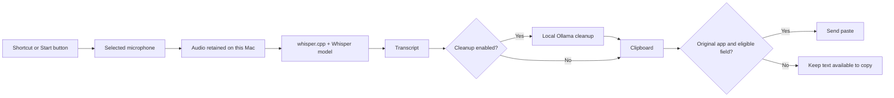

# Terry Tibbs

**Talk. Release. Your words appear.** Offline dictation for your Mac.

```text
Microphone menu                      Close window: keep Terry running
  Open Terry Tibbs                   Quit Terry Tibbs: stop Terry
  Settings
  Quit Terry Tibbs

Hold shortcut → Listening → Release → Transcribing → Paste sent
Double-tap    → Locked    → Press   → Transcribing → Paste sent
                       Escape → Cancel
                       No eligible text field → Copied only
```

Terry lives behind the microphone icon in your menu bar. Hold your chosen key, speak, then release it. Double-tap to talk hands-free and press again to finish. Every successful transcription goes to your clipboard. Terry also attempts to paste into the text field in the app where you started, while that app is still focused. It never presses Send.

An offline Silero detector checks for speech before Whisper runs. Silent or non-speech attempts leave your previous transcript and clipboard alone. Speech recognition runs on your Mac with Whisper. No account, subscription or cloud speech service is required. Installation downloads dependencies and a model once. Dictation can then run offline.

**Status: 0.6.4, early source release.** Apple Silicon packaging is implemented and tested on an M2 Max. The source is public at [DilrajAhdan/terrytibbs](https://github.com/DilrajAhdan/terrytibbs). A signed, notarised installer is not available yet. MacBook Neo is a documented trial target, not a tested device. The project is not affiliated with Wispr Flow or any television character.

## Start here

| I want to… | Read this |
|---|---|
| Install on my Mac, including MacBook Neo | [Installation](docs/INSTALL.md) |
| Pick the right model for my hardware | [Models and hardware](docs/MODELS-AND-HARDWARE.md) |
| Set my shortcut, microphone and sounds | [Everyday use](docs/USER-GUIDE.md) |
| See graphs and understand the measurements | [Benchmarks](docs/BENCHMARKS.md) |
| Understand what stays on my Mac | [Privacy and security](SECURITY.md) |
| Help improve the project | [Contributing](CONTRIBUTING.md) |

## Which Mac and model?

- **MacBook Neo, 8 GB:** trial `small.en` for English, with optional cleanup off. Test speed and memory pressure on the actual machine before choosing it for daily use.
- **M-series Mac, 16 GB or more:** start with `large-v3-turbo`, the default download.
- **Powerful Mac with spare memory:** compare full `large-v3` against Turbo using your own speech. A larger model is a candidate to test, not a guarantee of fewer mistakes.
- **Intel, Windows and Linux:** the current Terry app and setup are not supported, even though whisper.cpp itself supports more platforms.

These are starting recommendations, not results from a hardware comparison. The [hardware guide](docs/MODELS-AND-HARDWARE.md) explains 8 GB Macs, multilingual use and model switching.


## One-command source installation

0. Use an ARM64 Mac with macOS 15+, Xcode Command Line Tools, Homebrew and Node.js 22.12+. Clone this repository, or download and extract its source ZIP, then open Terminal in that folder. Allow 10 GB free space, plus space for developer tools. A first install needs internet.
1. Run:

   ```sh
   git clone https://github.com/DilrajAhdan/terrytibbs.git
   cd terrytibbs
   npm run install:mac
   ```

   This installs pinned project dependencies, the Homebrew speech engine if missing, the verified Turbo model and the app in **~/Applications**, then opens it. It refuses to overwrite an existing app. This is one command **after prerequisites and source download**, not a zero-prerequisite installer. The default model is a 1.62 GB download; 8 GB Macs should use the [smaller-model route](docs/INSTALL.md#macbook-neo-use-a-smaller-model-first).
2. Allow Microphone and Accessibility, choose a shortcut, then test in TextEdit. Closing the window keeps the microphone menu icon running; Quit stops it. Login launch is not automatic.

A DMG build is available with `npm run dist`. Current DMGs are **unsigned and require the separate speech engine/model**. They are local preview installers, not a finished public installation experience. See [release readiness and the proposed Homebrew route](docs/RELEASE.md).

## What is included

Terry has a configurable hold shortcut, double-tap lock, a 104 × 28 pixel recording indicator, microphone selection and input test, vocabulary hints, local transcription, clipboard output, focus-checked paste, cancellation, retry and WAV import. Dictation is limited to two minutes per recording.

**Quick buzz** is a short nonverbal cue that does not delay capture. **Keep microphone ready** is optional: it keeps up to 120 ms of idle audio in memory, discards unused samples and pauses on lock or sleep. It is off by default. Voice clips and Mac chime deliberately delay capture until they finish and settle. See [sounds and readiness](docs/USER-GUIDE.md#sounds-and-first-words).

Background audio muting silences other apps during dictation and restores their output afterwards. The transition can take time, so immediate microphone capture and complete muting do not happen at the same instant. Optional local Ollama cleanup is off by default; ordinary dictation needs no separate language model.

## How it works



The latest recording and transcript are held in app memory for retry and copying. CLI fallback creates a temporary WAV and removes it on normal completion, failure or cancellation. The clipboard retains completed text independently. Read [the full privacy boundaries](SECURITY.md).

## Evidence and open source

The [benchmark guide](docs/BENCHMARKS.md) separates measured timings from hardware suggestions. The [release readiness report](docs/RELEASE.md) records recording, shortcut and paste checks with their limitations. There is no published accuracy benchmark of the maintainer's everyday speech or the MacBook Neo yet.

The source is [MIT licensed](LICENSE). Models and dependencies retain their own licences. No celebrity recordings or imagery are bundled; local clips supplied by a user remain outside the source licence. See [third-party notices](THIRD_PARTY_NOTICES.md). Release signing, a bundled speech runtime and a fresh-machine installation check are still release work.
