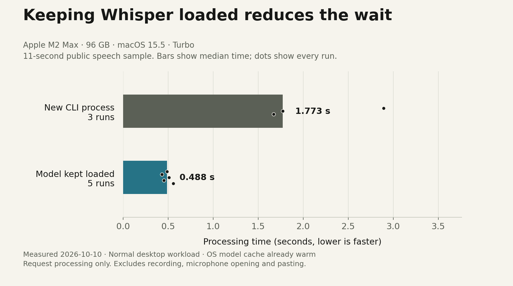

# What we have measured

[Home](../README.md) · [Models and hardware](MODELS-AND-HARDWARE.md) · [Detailed verification](RELEASE.md)

A useful comparison needs three things: the same speech, the same machine and an honest description of what the timer measures. A model can fit in memory and still feel slow. It can also produce one perfect demo sentence and still misunderstand names in everyday use.

## Model download sizes


These are file sizes from a pinned upstream revision, not measured accuracy or total memory requirements. The [model table](MODELS-AND-HARDWARE.md#model-sizes) provides the same values in text. The underlying [JSON](data/models.json) includes exact bytes and source links.

## Local transcription time



The current graph uses [raw benchmark runs](data/turbo-timings.json) from the included script, with Turbo on an M2 Max, 96 GB, macOS 15.5. The local engine package was whisper.cpp 1.9.4 at collection. It transcribes the public 11-second JFK sample shipped by whisper.cpp. All charted runs match the reference words after ignoring punctuation and case.

| Path | Runs | Median | Observed range |
|---|---:|---:|---:|
| New CLI process per request | 3 | 1.773 s | 1.672–2.892 s |
| Server with model already loaded | 5 | 0.488 s | 0.429–0.556 s |

Server startup was a separate 0.956 s observation, excluded from the warm-request bars. These are eight requests on one sample, not population statistics.

**How to read it:** a new CLI process loads the model for every request; the local server keeps it loaded between requests. The plotted warm requests start after the server is ready. Its separate startup time is recorded in the JSON. The model is read for its checksum before the benchmark, so even the new-process runs benefit from the operating system's file cache. They are not cold-boot measurements. CLI runs precede server runs under normal desktop load; this is a small diagnostic, not a controlled hardware study.

The graph measures the application's transcription call, including its file/HTTP handling. It excludes speaking time, microphone opening, the activation cue, cleanup, clipboard and paste delivery. It does not predict Neo performance. Earlier single-run observations remain in [the warm-engine notes](WHISPER-SERVER-NOTES.md); variation between runs is expected.

There is no established everyday word-error rate, name accuracy or accent benchmark for Terry yet. No accuracy percentage is inferred from the JFK result. Server and CLI long-recording context behaviour also differs; see the notes before assuming identical output for all recordings.

The Neo guide's `small.en` download/checksum command was also exercised in an isolated folder on this M2 Max. The downloaded file passed all eight reference-word checks through the same benchmark script. [Small-model validation data](data/small-en-validation.json) records those observations. This validates the model file and local engine path on the development machine, not installation or performance on a Neo.

## Reproduce the public-sample graph

0. Complete installation, open Terminal in the source directory and keep the same model, engine version and workload for comparisons. This procedure uses public audio only and does not open the microphone, change app settings or copy a transcript to the clipboard.
1. Fetch and verify the public fixtures, then run the benchmark with the installed default model:

   ```sh
   node scripts/e2e-fixtures.mjs
   npx tsx scripts/benchmark-speech.ts \
     "$HOME/Library/Application Support/Terry Tibbs/models/ggml-large-v3-turbo.bin" \
     > artifacts/my-turbo-timings.json
   ```

   Fixture preparation also downloads the small `tiny.en` test model. The benchmark runs three CLI requests, then five loaded-server requests. It stops its own server on completion or error. A mismatch produces an error, not a passing timing report. To compare another model, change only the model path and use a different output filename.
2. Check that the report is valid JSON with `referenceWordsMatch: true`, the expected model checksum, three `cliMs` values and five `warmMs` values. Record the installed version with `brew list --versions whisper.cpp`. Do not compare stale engine versions as though only the model changed.
3. To regenerate the documentation images from the committed data:

   ```sh
   python3 -m venv /tmp/terry-chart-env
   /tmp/terry-chart-env/bin/python -m pip install matplotlib==3.10.7
   /tmp/terry-chart-env/bin/python scripts/render-doc-charts.py
   ```

   Python is only a documentation tool, not required to run Terry. To chart a new accepted measurement, deliberately replace `docs/data/turbo-timings.json` with that reviewed result first. Keep its hardware, engine and conditions in this page up to date.
4. Open both PNGs under **docs/images**, check readable labels and numbers, and compare them with their JSON values. Both axes must start at zero. SVG versions are included for resizing and publication.

## Compare models on your own Mac

0. Choose around 20 short sentences representative of your actual work: ordinary speech, names, numbers, technical words and natural pauses. For an audio-controlled comparison, deliberately record a test set with your consent, keep it local and convert to the app's supported 16 kHz mono PCM16 WAV format, at most two minutes per file. Terry does not collect a personal dataset automatically.
1. Write down the intended words. Keep microphone position, language, vocabulary, noise, sound mode and cleanup setting constant. Start with cleanup off.
2. Import the same WAVs under **Dictation → Import a WAV file**, using each chosen model in turn. Use the same set for every candidate. For a separate live test, repeat hold/release and double-tap/press into a disposable TextEdit document, checking first/last words and actual insertion.
3. Record incorrect, missing and extra words. Word error rate is `(substitutions + deletions + insertions) / reference word count × 100`. Count names and numbers separately because a small overall score can hide important mistakes. Specify punctuation/case normalisation consistently.
4. Record several processing times, their median and slowest result, memory pressure, and whether paste reached the field. Avoid treating the model's processing time as total time from key release to insertion.
5. Choose the best balance for your work. Pass means fewer relevant errors with acceptable delay and stable recording/paste on the actual Mac. A failed microphone or paste control means repair that path before blaming the model. Publish only consented or public samples; keep personal recordings out of Git.

| Evidence | M2 Max development Mac | MacBook Neo |
|---|---|---|
| Public sample through current engine | Measured in chart data | Not yet measured |
| Physical input and audio restoration | Prior checks in verification log | Not yet tested |
| Everyday names/accent accuracy | Not yet established | Not yet established |
| End-to-end target-app delivery | App-specific boundaries in verification log | Not yet tested |
| Battery impact | Not measured | Not measured |

This table should grow as real evidence arrives. Blank or untested results are not zeros.
