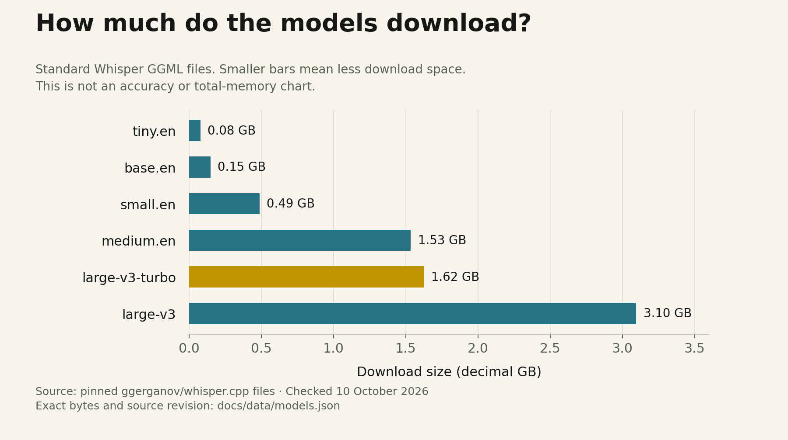

# Choose a model for your Mac

[Home](../README.md) · [Install](INSTALL.md) · [Graphs and measurements](BENCHMARKS.md)

There is no single best model for every Mac. Choose the model that makes few enough mistakes while returning your words quickly enough, with your normal apps open. Memory capacity decides what fits; chip performance and workload affect how long you wait.

**For an initial trial:** MacBook Neo owners can start with `small.en`. On a 16 GB or larger M-series Mac, start with Turbo. These are practical recommendations, not measured winners. The tested development machine is an M2 Max with 96 GB; that much memory is not a requirement.

## What the different names mean

| Part | Job | Terry 0.6.0 |
|---|---|---|
| Terry Tibbs | Shortcut, microphone, settings, clipboard and paste | Electron/Vue desktop app with native Swift helpers |
| whisper.cpp | Runs speech recognition on the computer | Separately installed `whisper-cli` and, when available, `whisper-server` |
| Whisper model | The learned speech recognition weights | Default: `ggml-large-v3-turbo.bin` |
| Ollama plus a text model | Optional rewriting of the recognised text | Off by default; uses a verified local model only |

A speech model listens to audio. A cleanup model receives text afterwards. Installing a large chatbot does not replace or improve the speech model automatically.

The installed engine uses Metal on the tested Mac. Upstream also supports an optional Core ML encoder path, but Terry's setup does not provision it. Having a Neural Engine does not mean this installation uses it. [Engine documentation](https://github.com/ggml-org/whisper.cpp#core-ml-support)

## Model sizes

Standard GGML files at the project's pinned upstream revision. GB/MB below are decimal download units. The memory estimates are approximate upstream model-family figures, not total Mac memory requirements or measurements of Terry. Turbo has no entry in that upstream memory table.

| Model | Download | Upstream runtime-memory estimate | When to try it |
|---|---:|---:|---|
| `tiny.en` | 77.7 MB | ~273 MB | Quick installation checks or severe constraints; scrutinise mistakes |
| `base.en` | 148.0 MB | ~388 MB | A lighter English alternative when small feels slow |
| `small.en` | 487.6 MB | ~852 MB | Starting English trial on an 8 GB Mac |
| `medium.en` | 1.534 GB | ~2.1 GB | Compare on difficult English; do not assume it is faster than Turbo |
| `large-v3-turbo` | 1.625 GB | Not published in this table | Terry's everyday default candidate |
| `large-v3` | 3.095 GB | ~3.9 GB | Accuracy comparison when additional latency is acceptable |

Sources: [pinned model files](https://huggingface.co/ggerganov/whisper.cpp/tree/5359861c739e955e79d9a303bcbc70fb988958b1), [whisper.cpp memory estimates](https://github.com/ggml-org/whisper.cpp#memory-usage). Checked 10 October 2026. Exact bytes and source URLs are in [chart data](data/models.json).

Download size is not an accuracy score. It is also not the app's total working memory: the engine, audio buffers, GPU allocations, Electron, macOS and your other apps need space too. OpenAI's reference GPU-memory figures belong to a different runtime and must not be substituted for missing whisper.cpp measurements.

## Turbo versus full large-v3

Turbo reduces the decoder from 32 layers to four and has about 809 million parameters versus 1.55 billion for large-v3. The model authors describe a speed gain with some quality loss. That makes full large-v3 a useful comparison, but it may not fix a particular name or accent. [Official Turbo model card](https://huggingface.co/openai/whisper-large-v3-turbo)

Published OpenAI relative-speed figures use an NVIDIA A100. They are not predicted Mac timings. Our graph uses only the local observations documented in [Benchmarks](BENCHMARKS.md). [OpenAI's comparison conditions](https://github.com/openai/whisper#available-models-and-languages)

`.en` means English-only. For other languages, choose a multilingual model, such as the corresponding name without `.en`, or Turbo/large-v3, then choose **Detect automatically**. Terry offers English or automatic detection and transcribes in the spoken language; it does not expose translation. Turbo is not trained for translation into English. [OpenAI usage guidance](https://github.com/openai/whisper#command-line-usage)

## Hardware starting points

The table is an editorial starting guide. No benchmark across these machines has been run. RAM thresholds are planning headroom, not enforced minimums.

| Your Mac | First model to try | Next comparison | Cleanup |
|---|---|---|---|
| MacBook Neo, A18 Pro, 8 GB | `small.en` for English | `base.en` if slow; Turbo if memory and latency allow | Off initially |
| M-series Mac, 8 GB | `small.en` or Turbo trial | Compare both with normal apps open | Off initially |
| M-series Mac, 16 GB | Turbo | `small.en` for less memory; full large-v3 for difficult speech | Optional; measure added delay |
| M-series Mac, 24–32 GB or more | Turbo | Full large-v3 against the same audio | More headroom, but still additional work |
| Tested M2 Max, 96 GB | Turbo | Full large-v3 is feasible to test, not yet benchmarked here | Currently off |
| Intel Mac / Windows / Linux | No supported Terry package | Engine support alone does not establish app compatibility | Not applicable |

For multilingual use, replace English-only candidates with multilingual models. A smaller file may reduce memory, but does not by itself establish faster recognition across different architectures.

### MacBook Neo specifically

Apple lists an A18 Pro chip, five GPU cores, 8 GB unified memory and 60 GB/s memory bandwidth. It is an Apple Silicon Mac, but not an M-series Mac. [Apple's specifications](https://www.apple.com/uk/macbook-neo/specs/)

Terry checks macOS plus `arm64`, so its setup is not restricted to chips named M1/M2/etc. That is a code-level compatibility indication, not an end-to-end Neo test. Start with the [Neo installation route](INSTALL.md#macbook-neo-use-a-smaller-model-first). Use the built-in microphone initially, keep cleanup off, and assess **Activity Monitor → Memory → Memory Pressure** while dictating with your normal apps open. Sustained yellow/red pressure or growing swap alongside slowdowns is a reason to try a smaller model or reduce competing load.

We have no measured Neo transcription time, accuracy, battery impact or physical shortcut/paste result yet. Keep those fields blank in comparisons until someone tests the real hardware.

## Switch models without rebuilding Terry

0. Obtain a compatible Whisper GGML `.bin` file from the [upstream repository](https://huggingface.co/ggerganov/whisper.cpp). Use a pinned revision and verify the downloaded file. The [installation guide](INSTALL.md#macbook-neo-use-a-smaller-model-first) provides a checked `small.en` example.
1. In **Terry menu → Settings → Speech engine → Model file**, choose the new file. In the file picker, **Command + Shift + G** lets you enter its folder path.
2. Set the appropriate language and **Save settings**. Let the engine load. Do not delete the previous model yet; it provides an easy rollback.
3. Dictate the same sentences with the same input device. Compare incorrect words, names, waiting time and memory pressure. Expand **View raw transcription** with cleanup off.
4. To roll back, choose the previous `.bin` file and save again. Check a known sentence before resuming daily use.

The app's download button and `npm run setup` always install Turbo. They do not select a model based on detected RAM. Model-file readiness checks alone do not prove a manually selected file is valid; successful transcription is the final check. Quantised Whisper files can use less space, but their quality and compatibility should be measured separately. No quantised recommendation is validated here.

## Optional cleanup and future engines

Local Ollama cleanup is a separate choice in **Settings → Local cleanup**. Start without it. If enabled, Terry accepts a locally installed model and talks only to `127.0.0.1:11434`; failure falls back to the real raw transcript. Check names, amounts and wording before treating a polished result as more accurate. Each cleanup model has its own resource requirements and licence.

WhisperKit is a possible future native engine, not something you can select in Terry today. It uses a different integration and model packaging. Adding it would need the same capture, recognition and paste tests as the current engine. [Official project](https://github.com/argmaxinc/argmax-oss-swift)

Terry source, whisper.cpp and Whisper weights use MIT licences; redistribution still requires the relevant notices. Optional models and user-supplied clips have their own terms. [Third-party notices](../THIRD_PARTY_NOTICES.md)

## Speech detection before transcription

Terry 0.6.2 also bundles **Silero VAD 6.2.0**, a separate 885 KB model that checks whether a recording contains speech. It runs locally on CPU through `whisper-vad-speech-segments`, before either the warm Whisper server or CLI. It is not a language model and does not write or edit text. A negative result leaves the clipboard untouched. Detector failures stop the attempt rather than bypassing the check.

The detector receives no vocabulary prompt. Accepted audio is passed to Whisper intact, preserving opening and final words. The 120 ms minimum speech segment is chosen to allow short utterances; no detector guarantees perfect separation of quiet speech, music or other speakers. This does not identify who is speaking.

On this M2 Max, individual checks of an 11-second speech sample and 2-second noise/buzz/hum fixtures took roughly 130–225 ms, including starting the detector process. This is work after release, not a startup delay. These are development observations, not a Neo benchmark or a universal latency guarantee. Model provenance, licence and checksum are in [third-party notices](../THIRD_PARTY_NOTICES.md).
